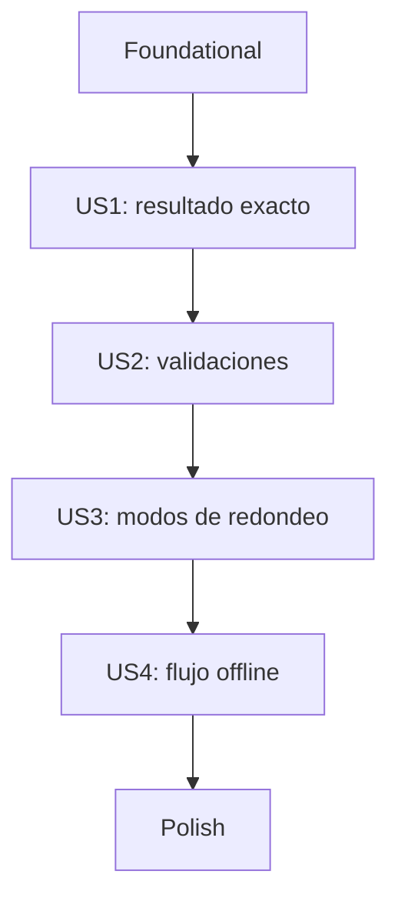

# Tareas: Divisor de cuenta

**Entrada**: documentos de diseño de `.specify/specs/001-dividir-cuenta/`

**Prerequisitos**: `plan.md`, `spec.md`, `research.md`, `data-model.md`, `contracts/` y `quickstart.md`.

**Pruebas**: incluidas porque FR-015 exige pruebas automatizadas para las reglas de cálculo y validación y para los escenarios de aceptación.

**Organización**: las tareas se agrupan por historia de usuario y respetan la independencia del dominio respecto de Flutter y de las implementaciones concretas. Las estrategias se definen mediante una abstracción en `domain/` y se implementan en `data/`; `main.dart` es el único punto de composición. No se agregan dependencias externas.

## Formato

- **[P]**: tarea paralelizable en un archivo distinto, sin depender de una tarea incompleta.
- **[US#]**: historia de usuario a la que pertenece la tarea.
- Todas las tareas incluyen una ruta concreta del proyecto.

## Convenciones de rutas

- Código Dart de la aplicación: `lib/`, organizado en `domain/`, `data/` y `presentation/`.
- Pruebas nuevas: `test/`
- Documentación de la feature: `.specify/specs/001-dividir-cuenta/`

## Phase 1: Setup

**Propósito**: el proyecto Flutter ya está inicializado y configurado. No se requiere crear otro proyecto, modificar dependencias ni configurar herramientas adicionales.

No hay tareas de setup pendientes.

---

## Phase 2: Foundational (prerrequisitos compartidos)

**Propósito**: establecer los tipos de dominio y los errores compartidos antes de implementar las historias.

- [ ] T001 Crear la abstracción `EstrategiaRedondeo` en `lib/domain/entities/estrategia_redondeo.dart`, definiendo la operación de redondeo del importe por persona.
- [ ] T002 [P] Definir en `lib/domain/errors/error_division.dart` las categorías de error necesarias para distinguir estos seis mensajes públicos: `Monto invalido`, `El monto no puede ser negativo`, `Debe haber al menos una persona`, `El número de personas debe ser un entero`, `Propina invalida` y `La propina debe estar entre 0 y 100`.
- [ ] T003 Crear `EntradaCuenta` en `lib/domain/entities/entrada_cuenta.dart`, con monto numérico mayor o igual a cero, personas enteras mayores o iguales a uno y porcentaje de propina entre cero y cien, inclusive.
- [ ] T004 Crear `ResultadoDivision` en `lib/domain/entities/resultado_division.dart`, conservando el total de la cuenta, la propina, el importe por persona y la información necesaria para identificar el modo de redondeo aplicado, sin depender de una implementación concreta de redondeo.

**Punto de control**: los tipos base están definidos, el dominio no depende de Flutter y no se ha creado una capa `data` sin necesidad.

---

## Phase 3: User Story 1 - Dividir una cuenta con resultado exacto (Priority: P1) - MVP

**Goal**: introducir monto, personas y propina y ver automáticamente el importe individual exacto con dos decimales.

**Independent Test**: con monto `100`, `4` personas y `10%` de propina, comprobar `27.50`; verificar también `90 / 3 -> 30.00` y `10 / 3 -> 3.33` en `Exacto`.

### Tests for User Story 1

- [ ] T006 [P] [US1] Crear pruebas unitarias para los tres escenarios exactos de aceptación en `test/domain/calcular_division_test.dart`.
- [ ] T007 [P] [US1] Crear pruebas de widget para mostrar y actualizar automáticamente un resultado exacto en `test/presentation/divisor_cuenta_page_test.dart`.

### Implementation for User Story 1

- [ ] T008 Implementar `CalcularDivision` en `lib/domain/use_cases/calcular_division.dart`, recibiendo una `EstrategiaRedondeo` mediante su abstracción y delegando en ella el redondeo del importe por persona, sin usar condicionales ni `switch` para identificar implementaciones concretas.
- [ ] T009 [US1] Implementar `DivisorCuentaController` en `lib/presentation/controllers/divisor_cuenta_controller.dart` para adaptar entradas e invocar el caso de uso cuando cambien.
- [ ] T010 [P] [US1] Crear el formulario de monto, personas y propina en `lib/presentation/widgets/entrada_cuenta_form.dart`.
- [ ] T011 [P] [US1] Crear el resumen que presenta `montoPorPersona` con exactamente dos decimales en `lib/presentation/widgets/resumen_division.dart`.
- [ ] T012 [US1] Integrar controlador, formulario y resumen en la única pantalla `lib/presentation/pages/divisor_cuenta_page.dart`, sin botón `Calcular`.
- [ ] T013 Configurar en `lib/main.dart` el punto único de composición, creando las implementaciones concretas `RedondeoExacto` y `RedondeoHaciaArriba` y proporcionando las dependencias necesarias a `CalcularDivision` y a la presentación, sin instanciar implementaciones concretas fuera de `main.dart`.

**Punto de control**: el flujo principal exacto funciona y se actualiza al editar entradas válidas.

---

## Phase 4: User Story 2 - Validar entradas (Priority: P1)

**Goal**: mostrar mensajes de negocio claros para entradas inválidas y ocultar el importe individual mientras exista un error.

**Independent Test**: verificar que `abc` muestra `Monto invalido`, que cero personas muestra `Debe haber al menos una persona`, y que las entradas inválidas no producen importe individual.

### Tests for User Story 2

- [ ] T014 [P] [US2] Agregar pruebas unitarias en `test/domain/calcular_division_test.dart` para las reglas de negocio: monto negativo, personas menores que uno, propina inferior a cero y superior a cien, y ausencia de cálculo ante entradas que incumplan las condiciones del dominio. Verificar las categorías de error del contrato.
- [ ] T015 [P] [US2] Agregar pruebas de widget en `test/presentation/divisor_cuenta_page_test.dart` para monto vacío, espacios, texto no numérico, coma decimal, monto negativo, personas cero o negativas, personas no enteras, propina vacía o no numérica y propina fuera del rango permitido. Verificar el mensaje exacto correspondiente y que no se muestre importe individual mientras exista un error.

### Implementation for User Story 2

- [ ] T016 [US2] Validar en `lib/domain/use_cases/calcular_division.dart` que el monto sea mayor o igual a cero, las personas sean un entero mayor o igual a uno y la propina esté entre cero y cien, inclusive; devolver el error de negocio correspondiente antes de calcular.
- [ ] T017 [US2] Adaptar las entradas de texto en `lib/presentation/controllers/divisor_cuenta_controller.dart`. Aceptar únicamente el punto como separador decimal para el monto y la propina; rechazar la coma decimal con `Monto invalido`. Distinguir texto vacío, no numérico, personas no enteras y valores numéricos fuera de rango, conservando los mensajes de la especificación.
- [ ] T018 [US2] Presentar el mensaje de validación y suprimir el resumen monetario cuando el estado contenga un error en `lib/presentation/pages/divisor_cuenta_page.dart` y `lib/presentation/widgets/resumen_division.dart`.

**Punto de control**: las entradas inválidas no producen resultados y los mensajes permiten identificar qué debe corregirse.

---

## Phase 5: User Story 3 - Elegir redondeo (Priority: P2)

**Goal**: permitir elegir entre `Exacto` y `Redondeo hacia arriba` y actualizar el resultado inmediatamente al cambiar de modo.

**Independent Test**: con monto `10`, `3` personas y `0%` de propina, comprobar `3.33` en `Exacto` y `4.00` en `Redondeo hacia arriba`.

### Tests for User Story 3

- [ ] T019 [P] [US3] Agregar pruebas unitarias de ambos modos en `test/domain/calcular_division_test.dart`, incluyendo el techo matemático, el caso de importe entero y el redondeo decimal de mitad hacia arriba.
- [ ] T020 [P] [US3] Agregar una prueba de widget que cambie el modo y compruebe la actualización automática de `3.33` a `4.00` en `test/presentation/divisor_cuenta_page_test.dart`.

### Implementation for User Story 3

- [ ] T021 Implementar `RedondeoExacto` y `RedondeoHaciaArriba` en `lib/data/strategies/`, aplicando respectivamente redondeo convencional a dos decimales y redondeo hacia arriba, y verificar que `CalcularDivision` delegue el cálculo a través de `EstrategiaRedondeo` sin identificar clases concretas.
- [ ] T022 [P] [US3] Agregar a `lib/presentation/widgets/entrada_cuenta_form.dart` un selector con exactamente las opciones `Exacto` y `Redondeo hacia arriba`.
- [ ] T023 [US3] Conectar el modo seleccionado con el controlador y recalcular al cambiarlo en `lib/presentation/controllers/divisor_cuenta_controller.dart`.

**Punto de control**: ambos modos cumplen el contrato numérico y el selector no requiere una acción adicional.

---

## Phase 6: User Story 4 - Funcionamiento offline (Priority: P2)

**Goal**: completar el flujo de cálculo sin conexión, backend, cuenta ni persistencia.

**Independent Test**: ejecutar el flujo localmente sin conexión y comprobar que las entradas, el cálculo y el cambio de modo siguen funcionando.

### Tests for User Story 4

- [ ] T024 [US4] Agregar una prueba de widget del flujo completo en `test/presentation/divisor_cuenta_page_test.dart`, utilizando el caso de uso local y sin servicios externos. Verificar que la entrada, el cálculo y el cambio de modo no requieren conectividad ni realizan solicitudes de red. No introducir dependencias de red para ejecutar la prueba.

**Punto de control**: el flujo funciona con datos en memoria y no depende de conectividad.

---

## Phase 7: Polish y concerns transversales

**Propósito**: comprobar arquitectura, cobertura de escenarios y calidad final de la feature.

- [ ] T025 [P] Revisar `lib/domain/` para confirmar que las reglas y errores no importen Flutter, Material ni detalles de plataforma, y que los nombres del dominio estén en español.
- [ ] T026 [P] Contrastar los escenarios manuales de `.specify/specs/001-dividir-cuenta/quickstart.md` con la pantalla final y actualizar la guía si la interfaz cambia.
- [ ] T027 [P] Contrastar los 13 escenarios de aceptación de las historias 1 a 3 y el escenario offline de la historia 4 con las pruebas automatizadas en `test/`; registrar cualquier escenario sin cobertura y completarlo antes de aceptar la feature.
- [ ] T028 Ejecutar desde la raíz `dart format --output=none --set-exit-if-changed lib test`, `flutter analyze` y `flutter test`; corregir fallos antes de aceptar la feature.

---

## Dependencias y orden de ejecución

### Dependencias entre fases

- **Setup (Phase 1)**: no requiere cambios; el proyecto Flutter ya existe.
- **Foundational (Phase 2)**: completar antes de las historias; T003 y T004 usan `ModoRedondeo`.
- **User Stories (Phase 3+)**: US1 establece el cálculo y la pantalla; US2 y US3 amplían el caso de uso y los widgets compartidos; US4 verifica el flujo integrado offline.
- **Polish (Phase 7)**: ejecutar después de las historias que se quieran entregar.

### Dependencias entre historias

- **US1 (P1)**: depende de la fase Foundational; entrega el MVP.
- **US2 (P1)**: se implementa sobre la pantalla y el caso de uso creados por US1.
- **US3 (P2)**: se implementa sobre el caso de uso, controlador y formulario compartidos por US1; conserva las validaciones de US2.
- **US4 (P2)**: verifica el flujo integrado creado por US1 y extendido por las historias anteriores; no requiere una capa de datos.

### Oportunidades de paralelismo

- En Foundational, T001 y T002 pueden avanzar en paralelo; T003 y T004 comienzan cuando estén disponibles sus tipos requeridos.
- En cada historia, las pruebas unitarias y de widget pueden prepararse en paralelo si se coordinan las interfaces compartidas.
- En US1, T010 y T011 pueden trabajarse en paralelo una vez acordadas las propiedades que consumen; la integración de la página espera al controlador y ambos widgets.
- Las fases de historias se ejecutan en orden porque modifican el mismo caso de uso, controlador, pantalla y archivos de prueba.

## Estrategia de implementación

### MVP primero (solo User Story 1)

1. Completar la fase Foundational.
2. Completar US1: cálculo exacto de propina e importe por persona, pantalla única y actualización automática.
3. Validar el criterio independiente de US1 con `27.50`, `30.00` y `3.33`.
4. Continuar con US2 para habilitar mensajes claros ante entradas inválidas.

### Entrega incremental

1. Fase Foundational: tipos del dominio.
2. US1: flujo principal exacto (MVP).
3. US2: validación y manejo visible de errores.
4. US3: selector de redondeo.
5. US4: comprobación del flujo sin conectividad.
6. Polish: formato, análisis, pruebas y verificación de quickstart.

## Notas

- `[P]` indica archivos distintos y sin dependencia de una tarea incompleta.
- `[US#]` vincula la tarea a la historia indicada en `spec.md`.
- No se incluyen cambios a dependencias ni a las carpetas de plataforma.
- Las pruebas nuevas deben agregarse sin modificar tests preexistentes salvo autorización explícita.
